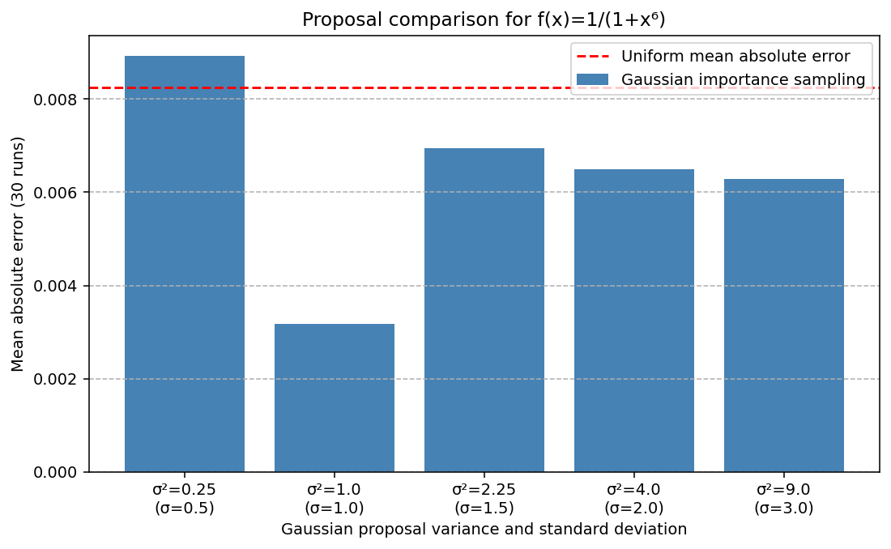

# Monte Carlo methods

A Numerical Methods group project exploring how random sampling estimates
integrals, and how its error and computational cost compare with quadrature.
The notebook covers 24 exercises: uniform and hit-or-miss sampling, importance
sampling, rectangles and discs, and tensor grids in higher dimensions. Estimators
use NumPy; SciPy supplies probability densities and quadrature references.

## Run

Python 3.12; tested with 3.12.14. From this folder:

```bash
python -m venv .venv
source .venv/bin/activate
python -m pip install -r requirements.txt
python run_notebook.py
```

On Windows, activate with `.venv\Scripts\activate`. The runner executes the
Python cells sequentially in one process, with seed 20261017, at most 50,000
random samples and up to 30 repeats. No dataset or external service is needed.
It updates notebook outputs, ten figures and `results/run-summary.json`.

For a smaller run:

```bash
python run_notebook.py --max-samples 10000 --repeats 5 --output results/small-rerun.ipynb
```

Figures and the summary are overwritten even with a different output notebook.
Use `python run_notebook.py --engine jupyter` for a real kernel. Requirements
include its kernel/client, not a notebook editor. Sequential execution has been
checked; execution through a real Jupyter kernel remains unverified.

## Results

Saved reduced experiments were run on 17 October 2026. For `1/(1+x**6)` on
`[-3,3]`, 50,000 samples and 30 repeats gave mean absolute errors of **0.008257**
with uniform sampling and **0.003167** with a Gaussian proposal of variance 1.
That proposal performed best among the five tested variances in this run.



The measured convergence slope in exercise 8 was −0.435, compared with the
standard-error reference exponent −0.5. Finite random experiments produce noisy
slopes; these figures do not establish a universal optimum or exact rate.
Full values and settings are in [the summary](results/run-summary.json).

## Limits

Importance sampling needs suitable support and finite weight variance. In the
special proportional-proposal example, knowing the normalising constant already
supplies the integral. Disc integration uses the known area; a separate
acceptance-fraction calculation estimates area without using π.

Cost comparisons count candidate points per estimate and separately record
integrand evaluations. Repeated error measurements cost multiple estimates.
The vectorised sampler uses `O(n*d)` work and memory. The largest executed tensor
grid has 100,000 points; dimension 10 is projected only. Timings are single local
measurements, and independent higher-dimensional error references are absent.

## Tests and version notes

```bash
python -m unittest discover -s tests -v
```

Eight tests cover known integrals, importance weights, rejection support,
disc candidate/evaluation counts, empty acceptance, sample variance and seeded
reproducibility. They do not prove accuracy for arbitrary integrands.
[Technical notes](docs/technical-notes.md) explain the execution settings and
cost definitions. This version includes post-submission corrections to cost
counting, sample statistics and mathematical explanations, with seeded controls;
the 24 exercises and estimator families are retained.

## Academic context and credits

Group 4, Numerical Methods, iMAT, ICAI, Universidad Pontificia Comillas, 2025–2026.
This was a five-student team project.
The scope here is numerical integration;
the separate coursework finance extension is not included.
