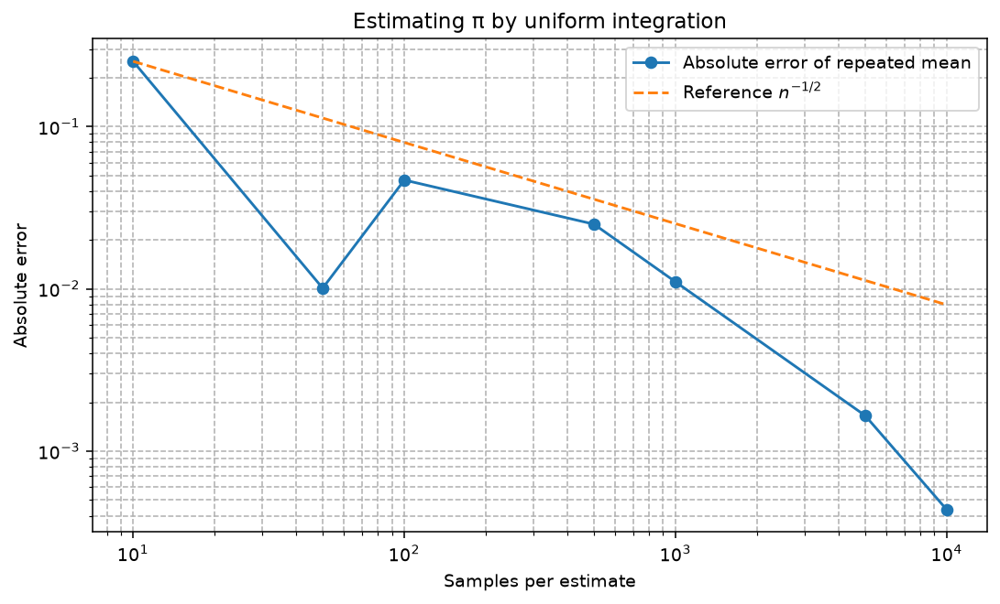
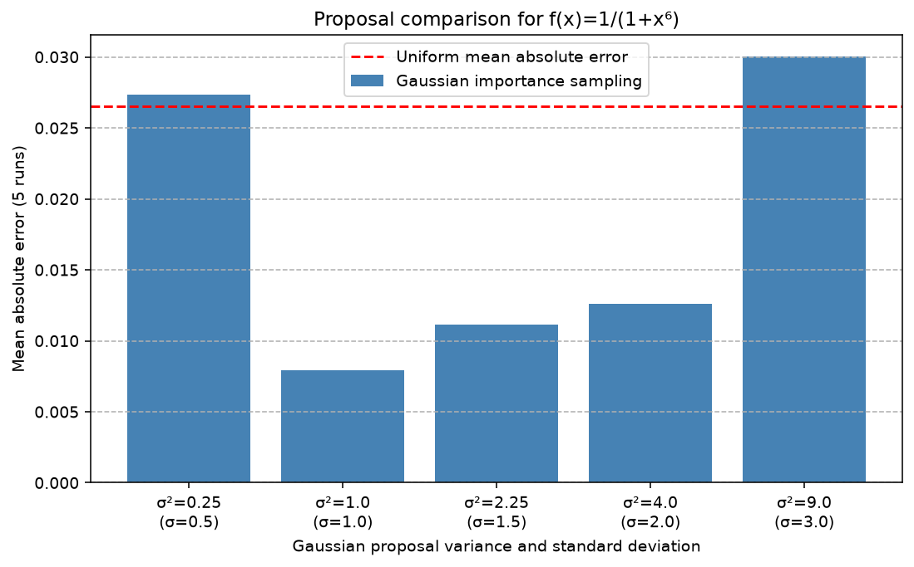

# Monte Carlo methods

How many random samples do we need to estimate an integral, and when does a
better sampling distribution help? In this five-student Numerical Methods
project, we explore those questions through 24 notebook exercises, from
one-dimensional integrals to the cost of tensor grids in higher dimensions.



Reduced experiment executed on macOS on 26 October 2026: at most 10,000 samples
per estimate and five repeats, with seed 20261017. The plot shows the absolute
error of the mean estimate of π. The dashed `n^(-1/2)` reference is scaled to the
first observation; it is not an error bound. The fluctuations are part of the
result. The original, larger experiment remains in `results/`.

## What we implemented

- Uniform Monte Carlo estimators in one and two dimensions, with repeated runs
  to examine sampling variation.
- Hit-or-miss integration for bounded, non-negative functions, and importance
  sampling with explicit proposal densities and rejection samplers.
- A left-rectangle rule, a midpoint grid clipped to a disc, and a tensor-grid
  comparison in higher dimensions.

Our notebook implements the estimators and experiments using NumPy arrays.
SciPy supplies probability densities, the error function and numerical
quadrature references; Matplotlib produces the figures.

## Quick start

The commands below were checked with **CPython 3.12.2 on macOS** and
**3.12.14**. Other Python versions have not been checked. Run from this
project folder:

```bash
python -m venv .venv
source .venv/bin/activate
python -m pip install --upgrade pip
python -m pip install -r requirements.txt -c constraints-tested.txt
python scripts/run_copy.py runs/smoke --seed 20261017 --max-samples 10000 --repeats 5 --engine in-process
```

On Windows, activate with `.venv\Scripts\activate` instead. No dataset or external
service is needed. This command executes **all 21 code cells**, covering all 24
exercises, with smaller sample and repeat counts. It writes an executed notebook,
ten figures and `results/run-summary.json` under `runs/smoke/`.

The wrapper copies the existing notebook and runner into a **new** directory,
then executes that unchanged runner. An existing destination is rejected, so use
a new name for each run. It contains no estimator implementation.

To run with the settings used by the historical figures:

```bash
python scripts/run_copy.py runs/default
```

Defaults are seed 20261017, a cap of 50,000 random samples and up to 30 repeats.
The larger run is optional. The verified smaller run checks execution and does
not claim numerical reproduction of the saved 50,000-sample experiments.
[Execution notes](docs/technical-notes.md) explain the runner, environment and
how to use an existing Jupyter installation.

## Reading the results

`run-summary.json` contains estimates, errors, proposal variances, candidate and
integrand-evaluation counts, and timings. In the **reduced macOS run shown here**,
integration of `1/(1+x**6)` over `[-3, 3]` gave:

| Method | Mean absolute error, 5 runs of 10,000 samples |
|---|---:|
| Uniform sampling | 0.026517 |
| Gaussian importance sampling, variance 1 | 0.007927 |



Same reduced run, seed 20261017. The variance-1 proposal performed best among the
five tested variances; variances 0.25 and 9 performed worse than uniform sampling.
This finite comparison does not establish a universally optimal proposal.
The exercise-8 mean adjacent log–log slope was −0.370; the theoretical
standard-error reference exponent is −0.5.

The **historical 17 October run** used 50,000 samples and 30 repeats for this
comparison, giving mean absolute errors of 0.008257 and 0.003167 respectively.
[Its original summary](results/run-summary.json) and figures are preserved.
The reduced run demonstrates execution at its stated settings, rather than
numerical reproduction of that larger experiment. The project also records a
separate default-settings check; its scope is explained in the
[execution notes](docs/technical-notes.md#separate-default-settings-check).

## Tests and limits

```bash
python -m unittest discover -s tests -v
```

Eight checks cover known integrals, importance weights, truncated support,
disc counters, empty acceptance, sample variance and seeded reproducibility.
All eight passed on macOS with Python 3.12.2 and the direct-dependency set in
`constraints-tested.txt`; `pip check` also found no conflicts. The reduced run
produced a notebook with 21 executed code cells and no error outputs. Sequential
execution is checked; real Jupyter-kernel execution remains unverified. Installation and tests alone do not reproduce scientific results.

`tests/test_output_argument.py` adds five tests of the runner's `--output` and
`--results-dir` handling (the longer ones run the notebook with 100 samples and two
repeats, in temporary directories). With the eight checks above, all 13 passed on
Python 3.12.2 on macOS.

Importance sampling requires adequate support and finite weight variance. A
proposal proportional to the integrand is an explanatory ideal: its known
normalising constant already gives the integral. The disc estimator uses the
known area; a separate acceptance-fraction calculation estimates area without π.

Cost comparisons count candidate points per estimate and separately record
integrand evaluations. This vectorised sampler uses `O(n*d)` work and memory.
The largest executed tensor grid has 100,000 points; dimension 10 is projected
only. Timings are individual local measurements, and independent error
references are absent for the higher-dimensional cases.

## Where to look

| File or folder | Purpose |
|---|---|
| `monte_carlo_methods.ipynb` | Estimators, mathematical explanations and saved outputs |
| `run_notebook.py` | Existing sequential Python and optional Jupyter runner; `--results-dir` redirects figures and summary |
| `scripts/run_copy.py` | Safe execution in a new directory |
| `results/` | Historical figures and numerical summary |
| `docs/images/` | Two unedited figures from the reduced macOS run |
| `tests/` | Focused checks using the notebook's actual function definitions |

Group 4, Numerical Methods, iMAT, ICAI, Universidad Pontificia Comillas,
2025–2026; a five-student team project. This version includes post-submission
corrections to counters, sample statistics and explanations while retaining the
24 exercises and estimator families. The separate coursework finance extension
is not included.
