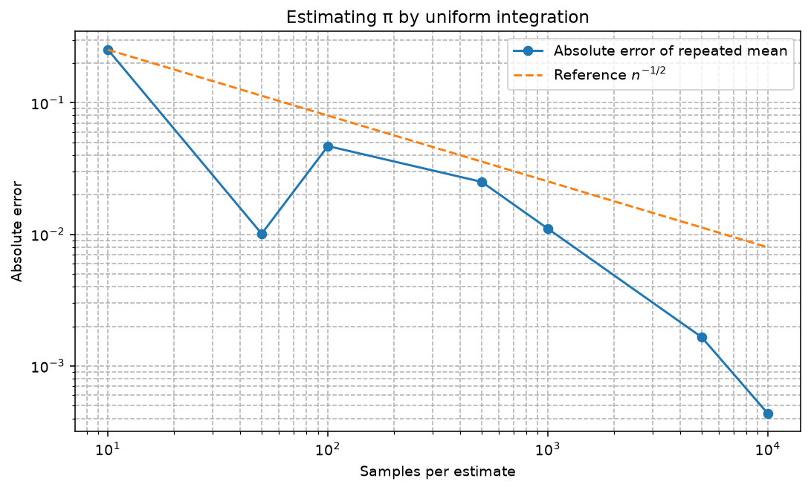
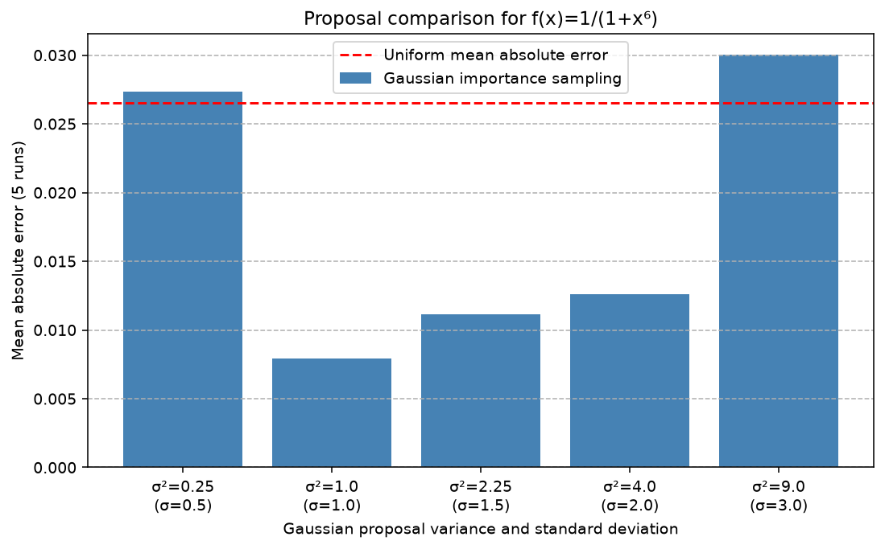

# Monte Carlo methods

NumPy implementations of Monte Carlo integration, rejection sampling and
importance sampling, compared with simple grid methods. The notebook explores
how sample size and the proposal distribution affect error and computational
cost, from one-dimensional integrals to higher-dimensional grids.

Numerical Methods coursework completed in a group of five, iMAT, ICAI,
Universidad Pontificia Comillas, 2025–2026. It contains 24 exercises.

[Run the notebook](#how-to-run) · [Results](#example-results) · [Code guide](#repository-structure) · [Numerical notes](docs/technical-notes.md)



Absolute error of the mean estimate of π, using up to 10,000 samples per
estimate and five repeats. The scaled `n^(-1/2)` line gives a reference slope;
it is not an error bound.

## What is implemented

- Uniform sampling in one and two dimensions, plus hit-or-miss integration for
  bounded, non-negative functions.
- Importance sampling with explicit proposal densities and rejection samplers.
- A left-rectangle rule, a midpoint grid clipped to a disc, and tensor-grid
  comparisons in higher dimensions.

The estimators are implemented in the notebook. SciPy supplies probability
densities, the error function and quadrature references; Matplotlib draws the
figures.

## Example results

For `1/(1+x**6)` on `[-3, 3]`, the displayed reduced experiment gave:

| Method | Mean absolute error: 5 runs of 10,000 samples |
| --- | ---: |
| Uniform sampling | 0.026517 |
| Gaussian importance sampling, variance 1 | 0.007927 |



Variance 1 gave the lowest error among these five proposals. Variances 0.25 and
9 performed worse than uniform sampling: importance sampling depends on the
choice of proposal, rather than automatically improving an estimate.

The images use a reduced experiment with seed 20261017. The saved
[`results/`](results/) files use a separate experiment with a 50,000-sample cap
and up to 30 repeats. The [run summary](results/run-summary.json) identifies
those settings; the two experiments should not be treated as the same run.

## How to run

Use Python 3.12 and run from the project folder:

```bash
python3.12 -m venv .venv
source .venv/bin/activate
python -m pip install --upgrade pip
python -m pip install -r requirements.txt -c constraints-tested.txt
python scripts/run_copy.py runs/smoke --seed 20261017 --max-samples 10000 --repeats 5 --engine in-process
```

No external dataset or service is needed. Choose a **new destination**: the
wrapper rejects an existing one. It runs all 21 code cells, covering the 24
exercises, and writes an executed notebook, ten figures and a run summary under
`runs/smoke/`. Start with this copy workflow to retain the committed outputs.

The [running notes](docs/technical-notes.md#running-the-notebook) explain the
default settings, Windows activation and optional Jupyter engine. Real
Jupyter-kernel execution has not been checked; the command above runs the cells
directly in Python.

## Repository structure

```text
monte-carlo-methods/
├── monte_carlo_methods.ipynb  # Estimators, explanations and saved outputs; start here
├── run_notebook.py            # Cell execution and result generation
├── scripts/
│   └── run_copy.py            # Wrapper that runs a copy and keeps earlier outputs
├── results/                   # Saved figures and the numerical run summary
├── docs/
│   ├── technical-notes.md     # Running and numerical notes
│   └── images/                # Figures shown in this README
├── tests/                     # Estimator and output-handling checks
├── requirements.txt
└── constraints-tested.txt     # Tested direct-dependency versions
```

## Tests and limits

```bash
python -m unittest discover -s tests -v
```

Tests cover estimators, sampling statistics, reproducibility and output handling.

- Importance sampling needs adequate support and finite weight variance. A
  finite comparison does not identify a universally best proposal.
- The largest executed tensor grid has 100,000 points. Dimension 10 is a cost
  projection, not an allocated or timed grid.
- Timings are local measurements. Higher-dimensional cases lack independent
  reference errors, and the plots do not establish asymptotic convergence.

The [numerical notes](docs/technical-notes.md#interpreting-costs-and-errors)
explain candidate counts, disc boundaries and other assumptions.
